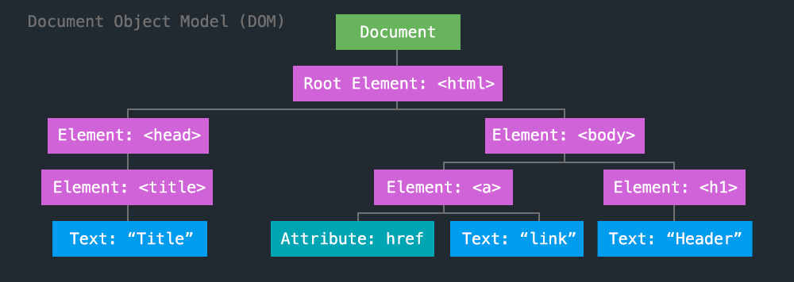
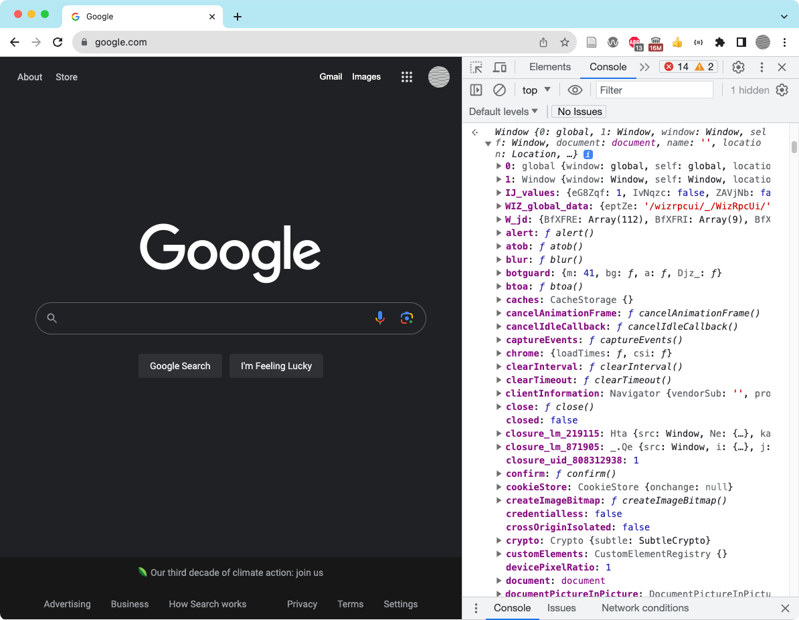

<!-- paginate: true -->

← [Learn Javascript](../../)

<a href="../../"></a>

# The DOM & Web Forms

Use form data via the Document Object Model (DOM)

<span class="slides-small"><a href="slides.html">slides</a> | <a href="dom.md">md</a></span>


<!--
Presentation comments ...
-->

<!-- 
---

## Contents

1. [Introduction](#introduction)
1. [Selecting HTML elements](#selecting-html-elements) `5 min`
1. [Next steps](#next-steps)
1. [Exercises](#exercises)
1. [References](#references)
 -->


---

## Introduction

<details>
<summary>Notes</summary>

Review the following sections and perform the activities on your own or with your group. Perform the task(s) when you see this 👉  emoji

</details>

<details>
<summary>Learning Objectives</summary>

Students who complete this module will be able to:

- Demonstrate how to
- Explain
- Use Javascript to
- List

</details>

<details>
<summary>Homework</summary>

- [Haverbeke Ch13 JavaScript and the Browser](https://eloquentjavascript.net/13_browser.html) (216-222)
- [Haverbeke Ch14 The Document Object Model](https://eloquentjavascript.net/14_dom.html) (224-241)
- [Haverbeke Ch15 Handling Events](https://eloquentjavascript.net/15_event.html) (243-259)
- [Haverbeke Ch18 HTTP and Forms](https://eloquentjavascript.net/18_http.html) (308-328)

</details>


---

## About the DOM

- A browser parses a page and creates a `document` object with all the page elements
- This makes it easy to select element and access their HTML and CSS code.




---

## The `window` object

<div class="twocolumn">
<div class="col">

1. Type `window` and press return
1. Expand a property *`{}`* or function *`f`* to see more. 
1. Functions can be called in the console: `alert(123)` or `window.alert(123)` and press return.

</div>
<div class="col">



</div>
</div>


<div class="caption slides-small">
👉 View these properties and functions in the console (or access them with javascript using dot syntax).
</div>


---

## `window.document`


<div class="twocolumn1x2">
<div class="col">

- `window` includes the page and browser tab
- `window.document` or just `document` contains structure, content, and properties for the page only. 

</div>
<div class="col">


```js
// get property
window.document.body.style.background
// set the property
document.body.style.background = "red"

// get web page url property
window.document.URL
// set a property
document.location = "https://davidson.edu"

// replace the content of the body
document.body.innerHTML = "😃"
```

<div class="caption slides-small">
👉 Explore these in the console
</div>

</div>
</div>


---

## Select elements with `document.querySelector()`

<div class="twocolumn1x2">
<div class="col">

- The number of properties that can be accessed using *direct selection* (what we've done so far) is limited.
- <a href="https://developer.mozilla.org/en-US/docs/Web/API/Document/querySelector" target="_blank">document.querySelector()</a> returns references to any element you like using its CSS selector. 

</div>
<div class="col">

```html
<p id="greeting">Hello world</p>
```

```js
// store reference to element
let ele = document.querySelector("#greeting");

// get the text
console.log(ele.textContent);

// or set the text
ele.textContent = "Hello world!";
```

</div>
</div>


---

## Selecting *Many* HTML elements

<div class="twocolumn1x2">
<div class="col">

- <a href="https://developer.mozilla.org/en-US/docs/Web/API/Document/querySelectorAll" target="_blank">document.querySelectorAll()</a> returns <i>all</i> elements matching the specified selector in an array.

<div class="example">
Example:
<p style="color:red">Red</p>
<p style="color:green">Green</p>
<p style="color:blue">Blue</p>
</div>

</div>
<div class="col">

```html
<p style="color:red">Red</p>
<p style="color:green">Green</p>
<p style="color:blue">Blue</p>
```

```js
// get array of all <p> elements on a page 
let eles = document.querySelectorAll("p");
// use a loop to log them
eles.forEach(function(ele){
	console.log(ele)
})
```

</div>
</div>


---

## Listening for Form Events

👉 In <a href="https://codepen.io/pen" target="_blank">codepen</a> create `<form>` and `<input>` elements and add a `submit` listener.

```html
<form action="#" class="myForm">
	<input type="text" id="color">
	<button type="submit">Submit</button>
</form>
```

```js
// get reference
let myForm = document.querySelector(".myForm");
// listens for when the form was submitted
myForm.addEventListener("submit", function(event) {
	console.log("Form was submitted!");
})
```

<div class="caption slides-small">
❌ This is going to have issues. Anyone know why?
</div>


---

## Getting Form Data

- By default all web forms load a new page. Use <a href="https://developer.mozilla.org/en-US/docs/Web/API/Event/preventDefault" target="_blank">`preventDefault`</a> on the returned `event` object to prevent this. 
- Set the background color by referencing the `this` (the form) `.color` (the input's id) and `.value` (its value).

```js
// get reference
let myForm = document.querySelector(".myForm");
// listens for when the form was submitted
myForm.addEventListener("submit", function(event) {
	event.preventDefault();
	document.body.bgColor = this.color.value;
})
```


---

## Change your HTML to start building the SUS form

Follow the book's prompt to make the form for Usability Test...

<div class="twocolumn">
<div class="col">

```html
<form action="#" class="myForm">
	<input type="number" id="q1">
	<input type="number" id="q2">
	<button type="submit">Submit</button>
	<input type="number" id="answer">
</form>
```

</div>
<div class="col">


```js
myForm.addEventListener("submit", (event) => {
	event.preventDefault();
	let q1 = Number(this.q1.value);
	let q2 = Number(this.q2.value);
	// add all converted responses
	let answer = (q1 + q2);
	// store in a new input and log to the console
	this.answer.value = answer;
	console.log(answer);
});
```

</div>
</div>


---

## Next steps

1. Try the [Exercises](#exercises) below.
1. Start working on homework listed in the schedule.
1. Continue to the [next lesson](../../).


---

## Exercises

👉 **Try it out**

1. [The Lottery v.2](demos/games/the-lottery/) - responding to events, [The Lottery v.3](demos/games/the-lottery/) - displaying content in the browser
	- Already finished? Add a way to spend more money in the lottery game
1. Exercises from Eloquent Javascript
	- Exercises: Ch14 [Build a table](https://eloquentjavascript.net/14_dom.html#h_TcUD2vzyMe), [Elements by tag name](https://eloquentjavascript.net/14_dom.html#i_VSftnyRTsV), [The cat’s hat](https://eloquentjavascript.net/14_dom.html#i_b/LAqZUqyo)
	- Ch15 [Balloon](https://eloquentjavascript.net/15_event.html#i_ZPJB9UFdQA), [Mouse trail](https://eloquentjavascript.net/15_event.html#i_NOgRH0Y9st), [Tabs](https://eloquentjavascript.net/15_event.html#i_Kk1WKx2anJ)
	- Ch18 [Content negotiation](https://eloquentjavascript.net/18_http.html#i_uaWwL8WGXf), [A JavaScript workbench](https://eloquentjavascript.net/18_http.html#i_wTXvIH5Wds), [Conway’s Game of Life](https://eloquentjavascript.net/18_http.html#i_XyKQVmCbTN)


---

## References

- Haverbeke [Ch2 Program Structure](https://eloquentjavascript.net/02_program_structure.html) (22-26)
- Codecademy Cheatsheet(s) [Conditionals](../../reference-sheets/js-02-conditionals.pdf)
- w3schools [Javascript practice](https://www.w3schools.com/js/exercise_js.asp)


---

## jQuery and The DOM

jQuery is a Javascript library you will see often in code references. It provides easy access to properties and methods in the HTML DOM, but it is better to learn "pure JS" (a.k.a. "vanilla").

NOTE: <a href="https://youmightnotneedjquery.com)" target="_blank">youmightnotneedjquery.com</a>


```js
// select all divs, set backgrounds red
$('div').css({ 'background': 'red' });
// select all elements with myClass, add text to end
$('.myClass').append(' - here is some new text');
```


---

## Forms and Events with jQuery

**Overview**: Events and using forms with Javascript and jQuery

NOTE: <a href="https://youmightnotneedjquery.com)" target="_blank">youmightnotneedjquery.com</a>

```js
// click event with callback
$('#submitButton').click(function() {
	// set the value of a form element
	$('#color').val("purple");
	// do not perform the default form action
	return false;
});
```

